<div align="center">

<picture>
  <source media="(prefers-color-scheme: dark)" srcset=".github/assets/banner-dark.svg">
  
</picture>

**Own the pixels when ordinary components are not enough.**<br>
Host native GPU surfaces and compiled shaders while command submission stays outside the PHP event loop.

[](https://packagist.org/packages/pushinbr/pam-native-gpu)
[](https://github.com/push-in/pam-native-gpu/releases/latest)

[](https://github.com/push-in/pam-native-gpu/actions/workflows/ci.yml)
[](LICENSE)

[Install](#install) · [Quick example](#quick-example) · [Platforms](#platform-support) · [Requirements](#requirements) · [Docs](#docs) · [Issues](https://github.com/push-in/pam-native-gpu/issues)

</div>

<a id="install"></a>
## <picture></picture> Install

Inside a PAM Native project, add only this capability:

```sh
pam composer require pushinbr/pam-native-gpu
pam doctor --fix
```

New to PAM? Create a project with `pam init my-app --template native` (see the [PAM Native overview](https://push-in.github.io/pam-docs/native/overview/)), then come back here. Composer owns the manifest and the lockfile; `pam composer` runs it on PAM's verified PHP runtime.

<a id="quick-example"></a>
## <picture></picture> Quick example

```php
use Pam\Native\Gpu\GpuProgram;
use Pam\Native\Gpu\GpuView;

$program = new GpuProgram(
    glsl: <<<'GLSL'
#version 300 es
precision highp float;
in vec2 v_uv;
uniform vec2 u_resolution;
uniform float u_time;
uniform float intensity;
out vec4 outColor;
void main() { outColor = vec4(v_uv, 0.5 + sin(u_time) * intensity * 0.5, 1.0); }
GLSL,
    metal: <<<'METAL'
fragment float4 pam_fragment(PamVertexOut in [[stage_in]], constant PamBuiltins& builtins [[buffer(0)]], constant float* values [[buffer(1)]]) {
    return float4(in.uv, 0.5 + sin(builtins.time) * values[0] * 0.5, 1.0);
}
METAL,
    uniforms: ['intensity' => 0.8],
);

return GpuView::make($program);
```

OpenGL ES 3 executes on Android and Metal executes on iOS. PHP supplies immutable shader programs and scalar uniforms; the native render loop never crosses the PHP boundary per frame. `GpuView::make()` also takes a `GpuRenderMode` (`Continuous` or `OnDemand`) and a revision, and `onEvent()` receives `GpuEventKind::Ready`, `Frame` or `Error`.

<a id="platform-support"></a>
## <picture></picture> Platform support

| Platform | Support | Notes |
| --- | --- | --- |
| Android | API 26+ | OpenGL ES 3 |
| iOS | 15.0+ | Metal, MetalKit, QuartzCore |
| PAM Native | 0.8.0 to < 2.0.0 | From `pam-native.plugin.json`; PHP 8.5+ |

<a id="requirements"></a>
## <picture></picture> Requirements and limits

No runtime permissions are declared on Android or iOS.

- Shader sources are capped at 64 KiB and uniforms at 64 finite scalars.
- Uniforms on Metal are packed in lexicographically sorted name order.
- Required PAM Native capabilities: `runtime.modules.v1`, `wire.binary.v1`.

<a id="what-you-can-build"></a>
## <picture></picture> What you can build

- Realtime visual effects and shader-driven UI
- Scientific and high-volume data visualization
- Custom renderers and GPU-accelerated creative tools

This package provides a horizontal GPU surface, not a canvas, 3D engine, game framework, or app template.

| | |
| --- | --- |
| **Best for** | A focused capability you can add to any PAM Native application |
| **Native path** | OpenGL ES · Metal |
| **Application model** | Composer package + generated native integration |
| **Design rule** | Independent module; no feed, vertical, or application template bundled |

<a id="performance"></a>
## <picture></picture> Performance

The render path is allocation-stable after a program revision: Android parses uniform JSON and resolves every OpenGL location during configuration, while iOS sorts and packs uniforms once and reuses one Metal command queue. Neither platform parses JSON, sorts maps, looks up shader locations, creates a command queue, or re-enters PHP inside `draw`. Shader and program resources are released after both successful and failed compilation, and diagnostic payloads are bounded.

This package depends only on PAM Native's public module and binary-wire capabilities. PAM Native UI, 3D, media, sync, and backend packages remain fully optional and independent.

<a id="docs"></a>
## <picture></picture> Docs

- [PAM Native overview](https://push-in.github.io/pam-docs/native/overview/)
- [PAM introduction](https://push-in.github.io/pam-docs/introduction/)
- [Report an issue](https://github.com/push-in/pam-native-gpu/issues)

<a id="pam-ecosystem"></a>
## <picture></picture> Part of the PAM ecosystem

<p align="center"><picture>
  <source media="(prefers-color-scheme: dark)" srcset=".github/assets/pam-wordmark-dark.svg">
  
</picture></p>

PAM runs PHP natively on servers, desktops and phones. This repository is one piece of it.

| [**PAM**](https://github.com/push-in/pam) | [**PAM Desktop**](https://github.com/push-in/pam-desktop) | [**PAM Native**](https://github.com/push-in/pam-native) | [**Ecosystem**](https://github.com/push-in/pam#ecosystem) |
| --- | --- | --- | --- |
| the runtime and CLI | native desktop apps in PHP | native Android and iOS apps in PHP | every official package and plugin |

<sub>Docs: [push-in.github.io/pam-docs](https://push-in.github.io/pam-docs/introduction/) · [Issues](https://github.com/push-in/pam-native-gpu/issues)</sub>

<p align="center"><sub><a href="LICENSE">Apache License 2.0</a> · Made in Brazil by Pushin</sub></p>
